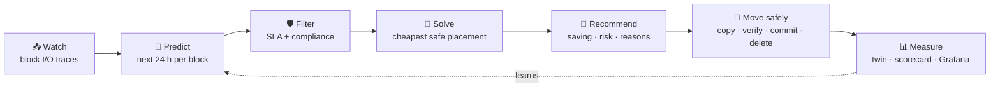
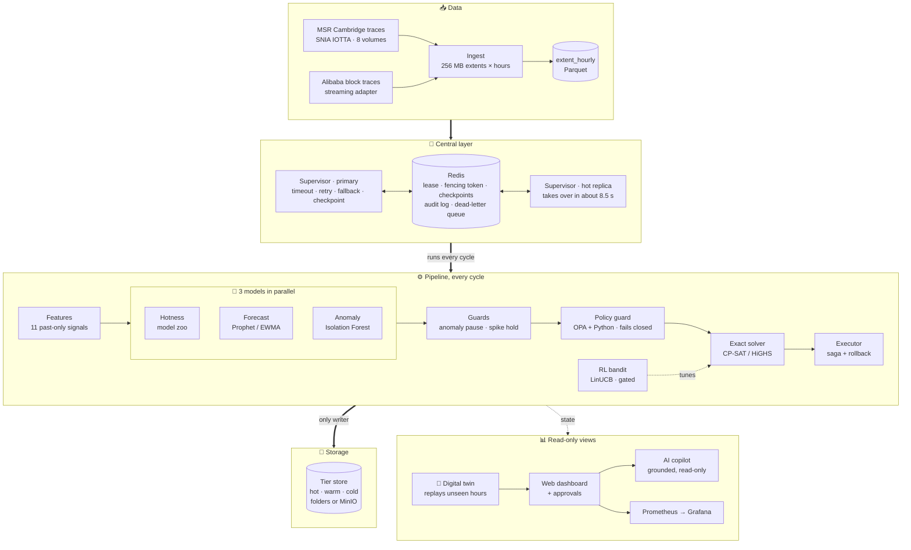
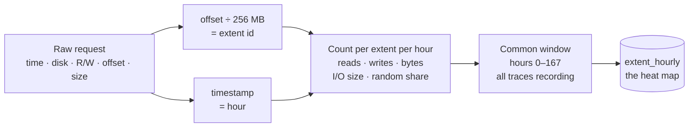
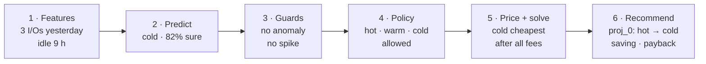
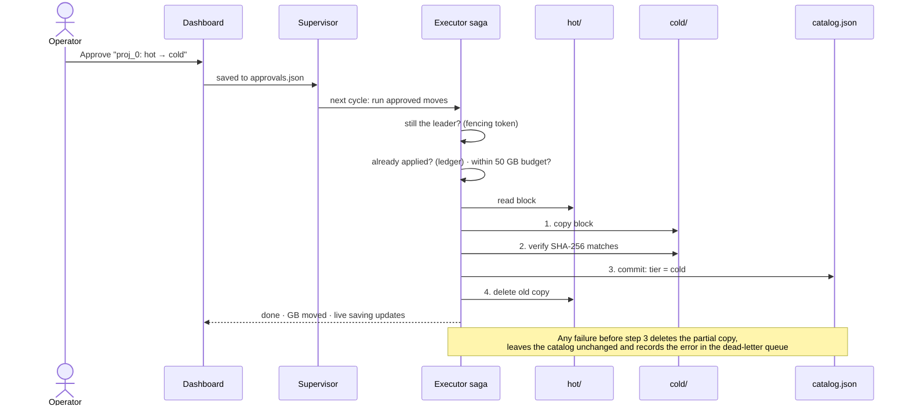
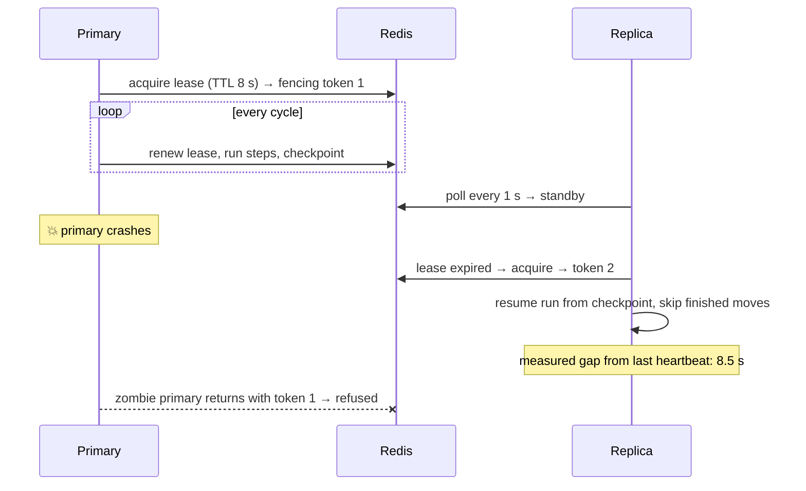
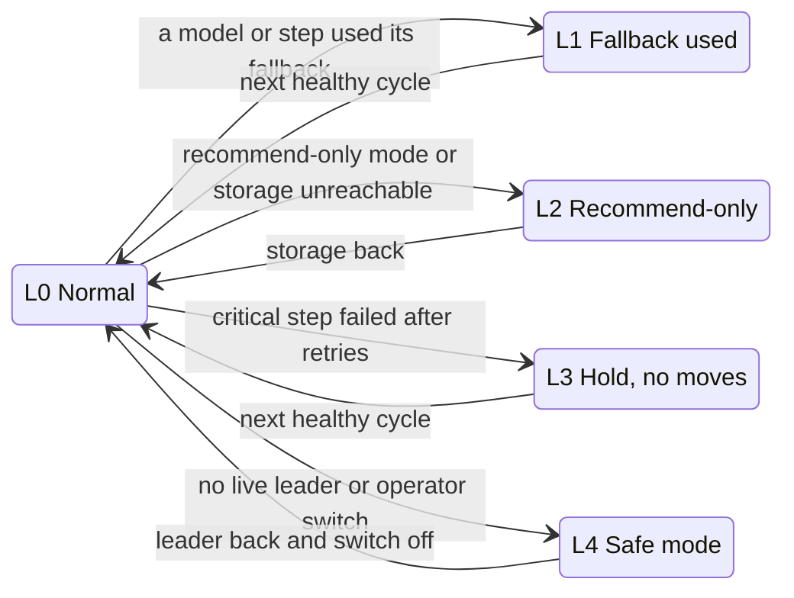
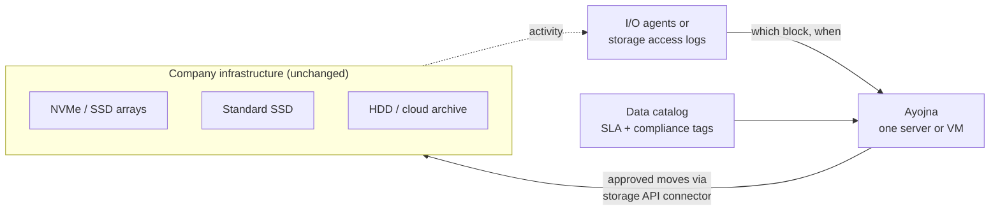

<div align="center">

# 🗂️ Ayojna

### A recommendation engine that plans where every byte should live

**Predict tomorrow's hot data · Place it on the cheapest storage that keeps its promises · Move it safely, even when things fail**

<br/>


**🏫 KLE Tech, Hubballi** · **✅ 150+ automated tests** · **📊 Data: MSR Cambridge traces (SNIA IOTTA)**

<br/>

| 💰 **61.8%** | 📉 **14.5%** | ⚡ **100%** | 🛡️ **100%** | 🔁 **8.5 s** |
|:---:|:---:|:---:|:---:|:---:|
| cheaper than keeping all data hot | cheaper than the best policy-compliant rule | of I/Os within their latency SLA | of placements pass policy | failover to the hot replica |
| *median of 5 replays (59.8–62.4%)* | *median of 5 (10.0–15.8%)* | *worst replay 99.5%* | *legal hold never moved* | *0 unsafe actions in chaos drill* |

<sub>Real MSR Cambridge enterprise traces · 8 volumes · scored only on hours the models never saw (120–167)</sub>

</div>

---

## 📑 Contents

| | | |
|---|---|---|
| 1. [The problem](#-the-problem) | 7. [Where data lives and how it moves](#-where-data-lives-and-how-it-moves) | 13. [Quick start](#-quick-start) |
| 2. [What "modern workloads" means](#-what-modern-workloads-means) | 8. [Reliability: the central layer](#-reliability-the-central-layer) | 14. [Live demo script](#-live-demo-script) |
| 3. [What Ayojna does](#-what-ayojna-does) | 9. [The dashboard](#-the-dashboard) | 15. [API](#-api) |
| 4. [Architecture](#️-architecture) | 10. [Results](#-results) | 16. [Repository structure](#️-repository-structure) |
| 5. [From raw I/O to a storage decision](#-from-raw-io-to-a-storage-decision) | 11. [How it compares](#️-how-it-compares) | 17. [Testing](#-testing) |
| 6. [The models and what they output](#-the-models-and-what-they-output) | 12. [Tech stack](#-tech-stack) | 18. [Limitations, integration, roadmap, team](#️-limitations) |

---

## 🔥 The problem

Enterprises keep almost all their data on **expensive, fast storage**, although most of it is rarely read. The [CTERA Cold Data Report (2026)](#-team-and-credits) finds only **4.4%** of enterprise file capacity actively used and **88%** of files untouched for a year.

| Tier (our price model) | Example hardware | $/GB-month | Base latency | Retrieval | Minimum stay |
|---|---|---:|---:|---:|---:|
| 🔴 **Hot** | NVMe / premium SSD | 0.100 | 0.1 ms | free | none |
| 🟠 **Warm** | Standard SSD | 0.045 | 0.5 ms | free | none |
| 🔵 **Cold** | HDD / infrequent-access object | 0.0125 | 8 ms | $0.01/GB | 30 days |
| ⚫ **Archive** | Deep archive | 0.002 | hours | $0.02/GB | 90 days |

Hot costs **8×** cold. Moving costs $0.001/GB, and leaving cold before 30 days pays an early-deletion fee.

**Why today's tools fall short:**

1. **Reactive.** Timers ("not touched for 30 days → cold") move data *after* it cools and get caught by month-end spikes.
2. **One-dimensional.** They look at access age only. They don't weigh each workload's latency promise, its compliance rules, and the fees together.
3. **Blind to the cost of acting.** Demoting data and promoting it back within 30 days pays an early-deletion fee plus two moves; a timer can't see that it lost money.

---

## 🧩 What "modern workloads" means

A **workload** is the stream of reads and writes an application sends to storage. Modern storage serves many very different workloads at once:

| Workload | I/O pattern | What it needs | In our data |
|---|---|---|---|
| OLTP database | Small random reads/writes, constant | ≈1 ms latency, always | `web_0` (web/SQL), `ts_0` (terminal server) |
| User and project files | Small hot working set, long cold tail | Fast for today's files | `usr_0`, `proj_0` |
| Source control | Bursty, legally retained | Never lose, never move under hold | `src1_2` (legal hold) |
| Logs and monitoring | Append-heavy, rarely read | Cheap capacity | `hm_0` |
| Media | Large reads | Throughput | `mds_0` |
| Print / backup-like | Write-mostly, read rarely | Cheapest storage, slow is fine | `prn_0` |

**Problem statement 2A** asks us to give each piece of data the **cheapest tier its workload can tolerate**, continuously, while never breaking a speed promise or a compliance rule.

---

## 💡 What Ayojna does

Every cycle, for every **256 MB block (extent)**, Ayojna answers one question: **"Where should this live for the next 24 hours, and is moving it worth it?"**



| Layer | What it does |
|---|---|
| 🔮 **Intelligence** | A model zoo (LightGBM, XGBoost, Random Forest, HistGB) predicts each block's hotness for the next 24 h; the champion is chosen on a validation window and explained per decision. A forecaster (Prophet, fallback seasonal EWMA) predicts I/O and capacity per volume, and an Isolation Forest flags anomalies. **All three run in parallel.** |
| 🧮 **Decision** | A policy guard (OPA / Rego, cross-checked by Python) removes illegal tiers first. An **exact solver** (OR-Tools CP-SAT or HiGHS MILP) picks the cheapest placement under capacity, queueing (SLA) and a 50 GB/h migration budget. A **LinUCB contextual bandit** tunes how eager to move, and acts only after it beats static settings. |
| 🔁 **Central** | A supervisor and a hot replica share state in **Redis**: lease, fencing token, checkpoints, audit log and dead-letter queue. Fail-safe levels **L0–L4** and an operator kill switch. |
| 🧾 **Execution** | Every move is a **saga** with rollback. Moves are idempotent, so a replica can resume a half-done run. |
| 📊 **Observe and validate** | Web dashboard with approvals, a grounded AI copilot, Prometheus + Grafana, a slide 6 KPI scorecard, a chaos drill, robustness and generalization tests. |

---

## 🏗️ Architecture



> [!IMPORTANT]
> **Only the executor writes to storage.** Everything else predicts, decides or reads. The dashboard, copilot and Grafana can fail without any risk to data.

---

## 🔬 From raw I/O to a storage decision

### 1 · What the dataset contains

The **MSR Cambridge traces** are one week of real disk I/O from Microsoft Research Cambridge's enterprise servers. Every request was logged with a timestamp, the disk, **read or write**, **offset** (where on the disk), **size** and response time. The traces record *which block was used and when*, not file contents.

### 2 · How a trace becomes a heat map



The **common window** matters. One trace (ts_0) runs about 26 h longer than the rest; after a trace stops, its volume looks idle and flatters every policy. We cut all volumes to hours 0–167.

### 3 · Features: each answers a storage question

| Feature | The question it answers |
|---|---|
| Accesses in last 1 / 6 / 24 / 72 h | How hot is it now, and how hot was it? |
| Hours since last access | Is it going cold? |
| 24 h vs 72 h trend | Heating up or cooling down? |
| Same hour yesterday, hour of day | Is there a daily cycle? |
| Read ratio | Reads from cold pay retrieval fees |
| Average I/O size, random share | Small random I/O suffers badly on HDD |

All features use **past hours only** (tested). Day-of-week is deliberately left out: with one week of data, the test day is a weekday the model never saw.

### 4 · Labels come from the future, not from people

The label is what *actually happened* to the block in the next 24 hours: **hot** = 50+ I/Os, **warm** = 1–49, **cold** = 0. No hand annotation. Train, validation and test are separate time windows with no overlap.

### 5 · Why SLA classes drive placement

Heat alone gives the wrong answer. A database block read 5 times an hour looks "cold-ish", but on HDD each read takes about 8 ms while the database promised 1 ms. So every volume carries an **SLA class**, and it sets the slowest tier allowed:

| SLA class | p95 latency target | Slowest allowed tier | Volumes |
|---|---:|---|---|
| OLTP | 1 ms | Warm | web_0, ts_0 |
| General | 10 ms | Cold | proj_0, usr_0, src1_2, hm_0, mds_0 |
| Backup | 1 s | Archive | prn_0 |

Latency also rises with load, so the planner models every tier as a queue:

$$\text{latency} = \frac{\text{base latency}}{1 - \text{utilization}}$$

Each tier is kept below the load at which its strictest SLA would break, with 30% headroom. That's why Ayojna sometimes serves busy data from **warm instead of hot**: same SLA, half the price.

> [!TIP]
> **In one line:** heat decides what's cheap, the SLA decides what's allowed, compliance decides what's legal, and the solver finds the cheapest point that satisfies all three.

### 6 · One decision, step by step



<sub>Illustrative example: one 256 MB block of proj_0. Below 60% confidence the block is not moved at all.</sub>

---

## 🤖 The models and what they output

| Component | Input | Output | Why it exists |
|---|---|---|---|
| **Hotness zoo**<br/>LightGBM · XGBoost · Random Forest · HistGB | 11 features per block-hour | P(hot / warm / cold), label, confidence, top drivers (TreeSHAP or occlusion) | Predicts tomorrow's temperature. The champion is picked on validation and must beat the rule baseline |
| **Forecast**<br/>Prophet → seasonal EWMA | Hourly I/O and working set per volume | Next-24 h I/O and capacity, **spike flag** (≥ 1.5× and ≥ 1,000 I/Os) | Sees bursts coming: a spike holds demotions on that volume |
| **Anomaly**<br/>Isolation Forest → robust z-score | Per-volume hourly behaviour | Score, PAUSE flag, most unusual feature | During an incident, moving data is risky: the volume is frozen |
| **Policy guard**<br/>OPA (Rego) + Python | Volume tags | Allowed tiers + reasons | Legal hold, no-archive (financial, PII), SLA floors. Fails closed |
| **Exact solver**<br/>CP-SAT / HiGHS / greedy | Expected load, allowed tiers, prices, capacity, queue limits, budget, current placement | MovePlan: from → to, saving/month, payback hours, risk | Cheapest *combination* for all blocks at once; never worse than greedy |
| **RL bandit**<br/>LinUCB | Load, burstiness, trend, SLA class per volume | cautious · balanced · aggressive | Learns how eager to move per workload; promoted only if it wins on a validation day |
| **Digital twin** | The replayed trace + every strategy | Cost, SLA met, compliance, GB moved per strategy | A "wind tunnel" for storage policies: same hours, prices and SLA model for everyone |

Every model has a **fallback**: rule baseline, seasonal EWMA, z-score rule, greedy plan. A missing library or a crashed model degrades the cycle (level L1); it never stops it.

---

## 💾 Where data lives and how it moves

### The tier store on disk

When the supervisor starts, every 256 MB block gets **one small placeholder file** on **hot** (the "before Ayojna" world). The trace has no file contents, so the placeholder stands in for the block.

```
data/tiers/
├── hot/
│   ├── proj_0/000041    ← one file = one 256 MB block of proj_0
│   └── web_0/000003
├── warm/
└── cold/
```

| What | Where | Code |
|---|---|---|
| Heat map (input) | `data/lake/extent_hourly.parquet` | `ayojna/ingest/real.py` |
| Block files (the storage) | `data/tiers/{hot,warm,cold}/<volume>/<extent>` or MinIO buckets | `executor/tierstore.py` |
| Which block is on which tier | `data/state/catalog.json` | `executor/catalog.py` → `seed()`, `switch()` |
| Human approvals | `data/state/approvals.json` | `recommend/approvals.py` |
| Moves already applied | `data/state/ledger.jsonl` | `executor/saga.py` |
| Latest plan / execution | `data/state/last_plan.json`, `last_exec.json` | `supervisor/pipeline.py` |
| Lease, audit, dead letters | Redis, or `data/state/*.json(l)` | `supervisor/state.py` |

### One move, end to end



Move economics stop data from bouncing between tiers:
- a move must clear a minimum gain (**hysteresis**);
- the move fee is paid back over a week of expected residency;
- early-deletion risk is priced in;
- at most **50 GB moves per hour**.

---

## 🔁 Reliability: the central layer

### Failover



### Fail-safe levels



| Mechanism | Guarantee | Measured |
|---|---|---|
| Lease + fencing token (Redis Lua scripts) | Exactly one leader acts; stale leaders are refused | Failover **8.52–8.86 s** (target ≤ 10 s) |
| Checkpoints + idempotent moves | A replica resumes; nothing is done twice | Crash at 40 moves → **40 skipped, 0 duplicates** |
| Step fallbacks | A broken model or planner degrades, never crashes | Chaos drill: **12 cycles, 7 fault types, 0 unsafe actions** |
| Saga rollback | A bad copy never becomes the truth | Corrupted copy → **rolled back**, catalog unchanged |
| Dead-letter queue | Every failure kept with its real error | Visible in the Central panel |

The state store is **Redis** when reachable and a **file store** with the same interface otherwise, so everything also runs on a laptop without Docker.

---

## 📊 The dashboard

Served by FastAPI at `http://localhost:8000`, refreshing every 3 seconds.

| Panel | What it shows |
|---|---|
| **Header badge** | Level L0–L4 · leader · fencing token · state store · lease seconds left |
| **KPI tiles** | Saving vs all-hot · saving vs best rule · SLA met · compliance · live saving · moves last cycle |
| **Recommendations** | One card per volume + direction: saving/month, confidence, risk, policy, drivers; **Approve / Reject / Why?** |
| **Decision trace ("Why?")** | 1 · prediction bars and drivers → 2 · allowed tiers → 3 · 24 h cost per tier → 4 · decision, payback, runner-up |
| **Intelligence layer** | Model leaderboard (champion highlighted) · parallel timing · forecast per volume · anomaly flags · active guards |
| **Decision layer** | OPA / Python agreement · solver and solve time · bandit arms and promotion status |
| **Central layer** | Leader, failovers, cycles by level, dead-letter queue, **safe-mode switch** |
| **Slide 6 scorecard** | All 9 targets with PASS / MISS and notes |
| **Generalization & robustness** | Median and range over 5 replays · unseen-volume test |
| **Charts** | Monthly cost by strategy · cumulative cost · live placement donut |
| **Last execution · Audit trail** | Done / skipped / rolled back / over budget · every cycle, approval and failover |
| **Ask Ayojna** | Copilot answers from system facts only; a guard rejects any invented number |

---

## 📈 Results

All on **8 real MSR Cambridge volumes**, scored only on **unseen hours 120–167**.

### Digital-twin race (one replay)

| Strategy | $/month | Saving vs all-hot | SLA met | Compliance | GB moved |
|---|---:|---:|---:|---:|---:|
| All hot | 21.08 | 0.0% | 100.00% | 100.0% | 0 |
| Access timer | 13.54 | 35.7% | 100.00% | 98.0% ❌ | 15.0 |
| LRU + policy | 11.16 | 47.0% | 100.00% | 100.0% | 129.75 |
| LRU | 10.27 | 51.3% | 100.00% | 96.2% ❌ | 180.0 |
| Age rule | 9.93 | 52.9% | 99.99% | 98.0% ❌ | 17.75 |
| LFU + policy | 9.41 | 55.4% | 100.00% | 100.0% | 21.0 |
| LFU | 7.86 | 62.7% | 100.00% | 97.5% ❌ | 21.5 |
| **🏆 Ayojna** | **7.92** | **62.4%** | **100.00%** | **100.0%** | **15.5** |

Plain LFU is $0.06 cheaper only because it moves **legal-hold data**. Rules that break policy are disqualified, so the fair baseline is **LFU + policy**.

### Robustness: median of 5 replays

| Measure | Median | Range |
|---|---:|---:|
| Saving vs all-hot | **61.8%** | 59.8 – 62.4% |
| Cheaper than the best compliant rule | **14.5%** | 10.0 – 15.8% |
| SLA met | **100%** | 99.5 – 100% |
| GB moved | 16.25 | 15.5 – 20.5 |

Near-ties in the plan flip with a one-in-a-billion nudge, and planning is sequential, so one replay is one sample. We report the median, not the best run.

### Slide 6 scorecard: 5 of 9 targets met, all 9 measured

| Target | Measured | Verdict |
|---|---|:---:|
| Cost ≥ 15% below the best rule at equal SLA | 14.5% median (best 15.8%) | ❌ close |
| ≥ 99% of I/Os within SLA | 100% | ✅ |
| Hotness macro-F1 ≥ 0.85 | 0.724 (rule 0.596) | ❌ |
| Hot-tier hit ratio above LRU/LFU | 34% (LRU 69%, LFU 91%) | ❌ by design |
| Capacity forecast MAPE < 15% | 3.1% at 24 h | ✅ |
| 100% of placements pass policy | 100% | ✅ |
| Data moved ≤ 5% of I/O | 8.5% | ❌ |
| ≥ 99.9% of cycles complete under failure | 100% | ✅ |
| Failover ≤ 10 s | 8.5 s | ✅ |

### More evidence

| Check | Result |
|---|---|
| Generalization: train on 4 volumes, test on 4 unseen | Hotness F1 **0.665** vs rule 0.625 (the model transfers); planner SLA **92.6%** (the plan does not yet) |
| Exact solver (HiGHS) | Optimal in 48 of 48 hours, about 76 ms per solve |
| RL bandit | Lost to static settings on validation (0.344 vs 0.336) → **kept in shadow mode** |
| Forecast | Capacity MAPE 3.1% · I/O MAPE 34.7% (24 h ahead) |
| Synthetic 7-day trace (sanity check only) | 68.5% vs all-hot · 37.8% vs best compliant rule |

---

## ⚖️ How it compares

| | Cloud auto-tiering<br/>(S3 Intelligent-Tiering, GCS Autoclass, NetApp FabricPool) | Cache rules<br/>(LRU / LFU) | **Ayojna** |
|---|:---:|:---:|:---:|
| Trigger | 30 days without access | Recent use | **24 h forecast** |
| Per-workload latency SLA | ❌ | ❌ | ✅ queue-aware |
| Compliance before cost | ❌ | ❌ | ✅ OPA, fails closed |
| Prices moves and early deletion | ❌ | ❌ | ✅ payback + hysteresis |
| Explains each decision | ❌ | ❌ | ✅ per-block trace |
| Human approval mode | ❌ | ❌ | ✅ |
| Crash-safe moves with failover | vendor-internal | n/a | ✅ saga + fencing |

Machine learning in storage is the industry direction: Meta, CMU and Microsoft's **Baleen** (FAST '24) uses ML for flash-cache admission. Ayojna applies prediction to **tiering** and adds SLA, compliance and move economics in one decision.

---

## 🧰 Tech stack

<div align="center">

**Language and data**


<sub>also: Apache Parquet / PyArrow data lake</sub>

**Machine learning**


<sub>also: Prophet forecaster</sub>

**Decision and policy**


**Platform and operations**


**AI copilot**


<sub>also: Ollama (free local model)</sub>

</div>

| Area | Used for |
|---|---|
| pandas, NumPy, PyArrow | Ingest, features, the Parquet data lake |
| Pydantic | Data contracts between modules (Move, MovePlan, Envelope) |
| scikit-learn, LightGBM, XGBoost | Hotness model zoo, Isolation Forest |
| Prophet | Volume I/O and capacity forecast (seasonal EWMA fallback) |
| TreeSHAP (native in LightGBM/XGBoost) | Per-prediction explanations |
| OR-Tools CP-SAT, HiGHS (SciPy MILP) | Exact placement solver |
| LinUCB (NumPy) | Contextual bandit for move eagerness |
| Open Policy Agent (Rego v1) | Policy as code, cross-checked by a Python guard |
| Redis 7 | Lease, fencing token, checkpoints, audit log, dead-letter queue (built-in RESP client, Lua scripts) |
| MinIO | S3-compatible object tiers (optional; folders by default) |
| FastAPI, Uvicorn, Chart.js | API and one-page web dashboard |
| Prometheus, Grafana | `/metrics` export and a provisioned live-KPI dashboard |
| Gemini, Groq, Anthropic, Ollama | Optional copilot language models; template answers without a key |
| Docker Compose | MinIO, Redis, OPA, Prometheus, Grafana |
| pytest | 150+ automated tests |

Optional libraries (LightGBM, XGBoost, Prophet, OR-Tools) are skipped cleanly when missing: the leaderboard shows "not installed" and the next option is used.

---

## 🚀 Quick start

```bash
git clone https://github.com/vaishnavi-212/Ayojna.git && cd Ayojna
python -m venv .venv
source .venv/bin/activate                 # Windows: .\.venv\Scripts\Activate.ps1
pip install -r requirements.txt && pip install -e .
pip install -r requirements-ml.txt        # optional: LightGBM, XGBoost, Prophet (macOS: brew install libomp)

python -m pytest -q                       # 150+ tests
python -m ayojna.demo --serve             # synthetic trace → http://localhost:8000
```

<details>
<summary><b>Real MSR Cambridge traces</b></summary>

1. Download **MSR Cambridge Traces** from [SNIA IOTTA](https://iotta.snia.org/traces/block-io/388) and accept the licence.
2. Put the archive(s) in `data/raw/msr/` without unzipping.
3. Run the whole pipeline and open the dashboard:
   ```bash
   python -m ayojna.demo --source real --serve
   ```
4. Then the validation suite:
   ```bash
   python -m ayojna.validate.robustness --runs 5   # median of 5 replays
   python -m ayojna.validate.kpi_report            # slide 6 scorecard (uses the median)
   python -m ayojna.validate.chaos                 # 12 cycles with injected faults
   python -m ayojna.validate.generalize            # train on some volumes, test on others
   ```
</details>

<details>
<summary><b>Full stack: Redis, OPA, MinIO, Prometheus, Grafana</b></summary>

```bash
cp .env.example .env              # set passwords; .env is git-ignored
docker compose up -d
python -m uvicorn ayojna.api.app:app --port 8000
python -m ayojna.supervisor.run --name primary --state-store redis --cycles 500 --interval 20 --approval
```

| Service | URL |
|---|---|
| Dashboard | `http://localhost:8000` |
| Grafana ("Ayojna · live KPIs") | `http://localhost:3000` |
| Prometheus | `http://localhost:9090` |
| OPA | `http://localhost:8181` |
| MinIO console | `http://localhost:9001` |

Without Docker, everything falls back to the file store and the Python policy guard.
</details>

<details>
<summary><b>Alibaba block traces (cross-dataset)</b></summary>

Access needs a survey ([github.com/alibaba/block-traces](https://github.com/alibaba/block-traces)). The adapter **streams** the 181 GB archive and keeps only the devices and days you ask for:

```bash
python -m ayojna.ingest.alibaba --src <.tar.gz path or https link> --first 8 --days 5
python -m ayojna.validate.generalize --target data/lake/alibaba_eh.parquet
```
</details>

<details>
<summary><b>AI copilot</b></summary>

Copy `.env.example` to `.env` and add any of `GEMINI_API_KEY`, `GROQ_API_KEY` or `ANTHROPIC_API_KEY`, or set `AYOJNA_LLM=ollama` for a free local model. Without a key the copilot answers from templates.
</details>

---

## 🎬 Live demo script

| # | Show | Command / action | What the audience sees |
|:-:|---|---|---|
| 1 | Start | `python -m ayojna.supervisor.run --name primary --cycles 500 --interval 20 --approval` | Leader token 1, steps timed, models in parallel, plan waiting for approval |
| 2 | Storage before | Open `data/tiers/hot/proj_0/` | One file per 256 MB block, all on hot |
| 3 | Explain a block | Dashboard → **Why?** on a recommendation | Prediction, allowed tiers, cost table, payback |
| 4 | Approve | **Approve** `proj_0: hot → cold` | Next cycle: files appear in `cold/`, catalog updated, live saving rises |
| 5 | Bad copy | `--cycles 1 --corrupt-move` | Checksum mismatch → **rolled back 1**, dead-letter entry |
| 6 | Failover | Start `--name replica`, run primary with `--crash-after-moves 40` | `TAKEOVER after 8.5 s`, token 2, **40 skipped** |
| 7 | Degrade | `--cycles 1 --fail forecast` / `--fail execute` / `--fail hotness` | Badge L1 / L2 / L3 |
| 8 | Kill switch | Dashboard → **Enter safe mode** | Badge **L4**, nothing moves |
| 9 | Results | Scorecard + robustness panels, Grafana | 61.8% · 14.5% · 100% SLA · 100% compliance |

---

## 🔌 API

| Endpoint | Returns |
|---|---|
| `GET /` | The dashboard |
| `GET /api/kpis` | Savings, SLA, compliance, live saving, level |
| `GET /api/status` · `GET /api/central` | Leader, token, lease, failovers, cycles by level, dead letters |
| `POST /api/safe-mode` | Operator L4 switch |
| `GET /api/intel` · `GET /api/decision` | Model zoo, forecast, anomaly · policy, solver, bandit |
| `GET /api/recommendations` · `GET /api/recommendations/detail` | Grouped actions · per-block decision trace |
| `POST /api/recommendations/decide` | Approve or reject a group |
| `GET /api/plan` · `/api/execution` · `/api/placement` · `/api/audit` | Plan, last execution, tier mix, audit trail |
| `GET /api/explain/{volume}/{extent}` | Tier, allowed tiers, policy reasons, planned move |
| `GET /api/scoreboard` · `/api/kpi-report` · `/api/validation` | Twin race, slide 6 scorecard, robustness + generalization |
| `GET /metrics` | Prometheus text format |
| `POST /api/ask` · `GET /api/copilot` | Grounded copilot answer · active model |

---

## 🗂️ Repository structure

```
Ayojna/
├── ayojna/
│   ├── ingest/        📥 MSR parser · Alibaba streaming adapter · synthetic generator
│   ├── models/        🔮 features · hotness zoo · forecast · anomaly · training
│   ├── policy/        🛡️ Python guard + OPA client
│   ├── planner/       🧮 optimizer · exact solver · bandit · guards · evaluation
│   ├── supervisor/    🔁 runner · Redis / file state · RESP client · safe mode · CLI
│   ├── executor/      🧾 tier store (folders / MinIO) · catalog · move saga
│   ├── twin/          🧪 digital twin · baseline strategies · race
│   ├── recommend/     💬 recommendation engine + approvals
│   ├── validate/      ✅ KPI scorecard · chaos drill · robustness · generalization
│   ├── api/           🔌 FastAPI app · service · Prometheus metrics
│   ├── copilot/       🤖 grounded LLM copilot
│   └── demo.py        🎬 the whole pipeline in one command
├── config/            ⚙️ tiers · SLA · compliance · models · planner · policy.rego · prometheus · grafana
├── docs/              📝 PPT_CHANGES.md
├── tests/             ✅ 25 test files
├── web/index.html     📊 dashboard
└── docker-compose.yml 🐳 MinIO · Redis · OPA · Prometheus · Grafana
```

> [!NOTE]
> Raw traces, the data lake, state, tier folders and trained models are **git-ignored**. The SNIA traces are used under their licence and are never redistributed here.

---

## ✅ Testing

```bash
python -m pytest -q
```

| Area | What the tests prove |
|---|---|
| Ingest | Bad rows rejected; streaming equals in-memory; Alibaba streams from a tar.gz and stops early |
| Features and ML | No future leakage; champion chosen on validation; fallbacks when a library is missing |
| Decision | Exact plan never worse than greedy; capacity, queue and budget respected; OPA and Python agree; fail closed |
| Central | Redis lease, fencing, takeover, dead letters, L4 safe mode, crash resume |
| Executor | Idempotent replay, rollback on a bad copy, a fenced leader moves nothing |
| Validate | Scorecard, chaos drill, robustness median, generalization split |
| API and observability | Every endpoint; valid Prometheus text (promtool when installed); Grafana queries only exported metrics |

---

## ⚠️ Limitations

- **Cost target not reliably met.** 14.5% median vs the 15% target; only the best replay passes. LFU + policy is a strong baseline.
- **The plan doesn't transfer yet.** On unseen volumes the hotness model holds up (F1 0.665), but planner SLA drops to 92.6%. Root cause: re-promotion and early-deletion fees, plus tight capacity on a 4-volume subset. Next step: price re-promotion risk in the solver.
- **One week of data.** Forecasts are scored 24 h ahead; weekly seasonality needs longer traces.
- **Simulated hardware.** Tiers are folders or MinIO buckets on one machine with placeholder block files. The move mechanism is real; cost and latency come from public price lists and a queueing model.
- **Tags are configured, not discovered.** SLA and compliance tags live in `config/compliance.yaml`; in production they would come from a data catalog.
- **Alibaba run pending.** The adapter is built and tested; the full cross-dataset run needs survey access and hours of streaming.

---

## 🏢 Integrating into a company



1. **No new hardware.** Existing SSD, HDD and cloud tiers stay; Ayojna runs as software on one server.
2. **Input:** agents on storage hosts (or the storage system's access logs) stream "which block, when", replacing the trace files.
3. **Output:** the folder/MinIO tier store is swapped for a connector to the company's storage API.
4. **Tags** come from the company's data catalog instead of YAML.
5. **Rollout:** recommend-only → approval mode → autopilot for low-risk moves, every action audited and reversible.

---

## 🛣️ Roadmap

- 💲 Price the risk of re-promotion in the solver (fixes the generalization gap)
- 📡 Live I/O feed: an eBPF block-I/O collector and a live trace replayer
- 🐳 Containerised API and supervisors for one-command cloud deployment
- 🔌 Native Ceph, NetApp and Pure Storage connectors on the same tier-store interface
- 🌐 Multi-site supervisor quorum; streaming telemetry at scale
- 🧠 Multi-objective RL trained on the digital twin
- 🏷️ Compliance tags synced from enterprise data catalogs
- 🌱 Carbon-aware tiering
- 🧪 Stretch goals not built: LSTM forecaster, English → policy translation

---

## 🧠 Design decisions

| Choice | Reason |
|---|---|
| 256 MB extents, 24 h horizon | Small enough to target hot spots; one daily decision matches the cost horizon |
| Labels from the next 24 h | Real behaviour, no hand annotation, no bias |
| Rule baseline + promotion gate | ML and RL must earn their place on a validation window |
| Policy before price, fail closed | Compliance can never be traded for money |
| Queue-aware SLA | Latency rises with load; base latency alone breaks promises |
| Exact solver with greedy fallback | Optimal when possible, always an answer |
| Compare with compliant rules only | Rules that break policy are not a fair baseline |
| Median of replays, unseen hours only | One lucky run is not a result |
| Saga with one commit point | All-or-nothing moves without distributed transactions |
| Read-only, grounded copilot | Explanation adds trust; decision power would add risk |

---

## 👥 Team and credits

<div align="center">

**Team CodeBlooded · KLE Technological University · Hackfest 2026 · Problem Statement 2A**

| Bhoomi B | Vaishnavi K | Joel B | Aditya P |
|:---:|:---:|:---:|:---:|

</div>

**Datasets.** MSR Cambridge block I/O traces, [SNIA IOTTA](https://iotta.snia.org/traces/block-io/388): D. Narayanan, A. Donnelly, A. Rowstron, *"Write Off-Loading: Practical Power Management for Enterprise Storage"*, USENIX FAST 2008. Alibaba block traces: [github.com/alibaba/block-traces](https://github.com/alibaba/block-traces). Traces are used under their licences and are not redistributed.

**References.**
[AWS: How S3 Intelligent-Tiering works](https://docs.aws.amazon.com/AmazonS3/latest/userguide/intelligent-tiering-overview.html) ·
[Google Cloud Storage Autoclass](https://docs.cloud.google.com/storage/docs/autoclass) ·
[NetApp FabricPool tiering policies](https://docs.netapp.com/us-en/ontap/fabricpool/tiering-policies-concept.html) ·
[Baleen: ML Admission & Prefetching for Flash Caches (FAST '24)](https://www.usenix.org/conference/fast24/presentation/wong) ·
CTERA Cold Data Report (2026)

<div align="center">
<br/>
<b>Ayojna</b> (आयोजना) means "planning" · <i>make every byte earn its place</i>
</div>
